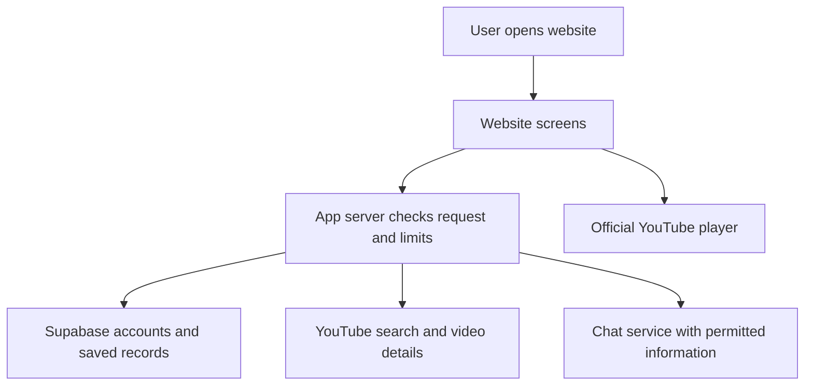

# Phase 2: developer answers and free starting tools

Date: 2026-10-12  
Based on the latest founder choices in [DEVELOPMENT_TASKLIST.md](DEVELOPMENT_TASKLIST.md).

## What I will build first

A mobile-friendly website for students and early-career professionals aged 18+ in India, in English:

1. Type any topic in everyday words.
2. See matching YouTube videos, scroll to load more, and choose what to watch.
3. Ask the chatbot a doubt and receive a useful answer and a real related video when available.
4. Save the search under a broad topic and reopen it next time.
5. After about 10–15 minutes of active learning, offer no more than two or three related entertaining clips.

Learner tests, understanding scores, and tile editing come later. Developer testing is still needed to make the app work correctly.

“Free first” means using free software and free service allowances, with no automatic paid upgrades. It does not mean unlimited internet search, unlimited AI, or permanent free service at any scale.

## 2.1 — Which tools will we use?

### My starting selections

| Job | Starting tool | Why it fits |
|---|---|---|
| Screens | React, TypeScript, Vite | A common way to build interactive web screens; TypeScript helps catch mistakes; Vite prepares the website files |
| Hosting and server requests | Cloudflare Workers with static website files | One place for website files and small server actions, including protecting API keys |
| Database and accounts | Supabase Free, using PostgreSQL | Stores users, saved searches, tiles, video details, and conversations; includes account features |
| Video search | Official YouTube Data API | Requests actual video results and details rather than scraping YouTube pages |
| Playback | Official YouTube embedded player | Plays permitted YouTube videos inside the site |
| Chat experiments | Gemini API free tier, starting with an available Flash-family text model | Has a free allowance; compare answer quality on checked questions before fixing the model |
| Chat alternative to evaluate | GroqCloud | Another hosted option; account-specific limits, available free access, terms, and quality must be checked before switching |
| Topic relationships | Ordinary database records | Enough for broad categories and small topic links; no separate graph service needed |
| Early reports | Our database and a basic staff report page | Avoid adding another reporting service initially |
| Website address | Hosting service's provided address | No need to buy a domain for the first test |
| Local tests | Free test tools selected with the code project | Test server rules and a complete browser journey without paying a testing service |

These are development selections, not accounts already created or integrations already proven. Verify exact package versions and free account availability when setting up the project. [Vite documents its React/TypeScript starter](https://vite.dev/guide/).

### Free service limits that matter

- Cloudflare currently lists 100,000 daily Worker requests on Free and a 10-millisecond CPU allowance per call; static-file requests are free. Keep the server work small and measure the implementation. Waiting for an outside API is different from time spent computing. [Cloudflare pricing](https://developers.cloudflare.com/workers/platform/pricing/).
- Supabase currently lists a 500 MB free database, 50,000 monthly active users, a two-active-project limit, and pausing after a week of inactivity. Managed automatic backups are not included in Free. Make our own protected exports and restore test; auth allowances alone do not establish total app capacity. [Supabase pricing](https://supabase.com/pricing).
- Gemini lists free input/output for certain models, including Gemini 2.5 Flash and Flash-Lite. Which model is available and its account limits must be checked at setup. [Gemini pricing](https://ai.google.dev/gemini-api/docs/pricing).

### Other free approaches considered

- Run the website/server locally and use a local PostgreSQL database during development. This saves hosting setup but does not provide an always-online app to students.
- Use Cloudflare D1 instead of Supabase for database storage. It has a free allowance, but accounts and access rules would need another solution. Keeping Supabase accounts/database together is simpler for this plan. [Cloudflare database allowances](https://developers.cloudflare.com/workers/platform/pricing/#d1).
- Run an AI model on an existing computer through Ollama for local experiments. This avoids hosted per-question API charges, but hardware, electricity, performance, model license, and keeping the computer online are real requirements. It is not automatically free public AI hosting. [Ollama local setup](https://docs.ollama.com/quickstart).

This is a practical shortlist, not a claim that every free provider has been investigated.

## 2.2 — How many separate applications do we need?

One main code project containing the website and its server actions. Supabase supplies accounts and database storage. YouTube and the AI provider supply videos/search and chat.

Do not start by building many separate systems. Separating a slow or heavily used part can happen later if measurements show a need.

## 2.3 — What parts will the code contain?

1. Home and discovery screens.
2. Search and scrollable video results.
3. Video playback and active-learning timer.
4. Accounts and guest access.
5. Broad topic tiles, smaller topics, and saved searches.
6. Chat, supporting sources, and related video suggestions.
7. Reviewed computing notes and content.
8. Topic map and visited-topic records.
9. Staff review/report tools.
10. Usage limits, error records, and basic reports.

Keep learner questions, score calculation, and tile-editing controls in the later-work list.

## 2.4 — How does information move?

The player obtains video playback through YouTube. We do not download and store copies of the videos. Secret YouTube/AI keys and privileged database keys stay on the server. User access must be checked before reading private saved topics or chats.

## 2.5 — How will we store topics and find useful information?

Use ordinary database tables for categories, smaller topics, connections, videos, searches, user tiles, conversations, notes, and activity.

- Save GPU and AMD searches under a broad Computing tile, with distinct smaller topics. Each saved smaller topic has one main tile; other subject links appear as related tags.
- Use known aliases and category rules for prepared topics.
- For unfamiliar searches, use a controlled set of broad categories and a low-confidence fallback such as Other until there is enough information. Do not force a wrong category.
- If AI helps classify a topic, check its returned category against allowed categories and the remaining free allowance.
- Save the original query and chosen category so returning users can reopen results.
- Start note search with topic and keyword matching. Add more advanced search only after measuring a gap.
- Apply current YouTube storage/refresh rules to provider details. Keep our own category labels and user activity separate from those details.

## 2.6 — Which free chat service should we start with?

**Start with Gemini for controlled adult prototype experiments, subject to its actual account access and terms.** Test a currently available free text model using around 20 reviewed questions. Compare with a Groq candidate if suitable free access is available. No real comparison has run yet, so there is no measured quality winner.

For each service, check accuracy, clear explanations, ability to use supplied notes, real source/video references, speed, and quota behavior. Keep provider-specific code behind a small shared interface so changing services does not require rebuilding the chat screen.

Important conditions: Gemini's current terms restrict API clients directed toward or likely to be accessed by under-18s. Its unpaid services may use input/output to improve products and may involve human review; the terms say not to submit sensitive, confidential, or personal information. Use eligible adult test access, explain handling to participants, avoid identifying profile data in prompts, and do not invite children to this configuration. Filtering alone cannot guarantee arbitrary user text is free of personal information. Reassess the provider before public use. [Gemini terms](https://ai.google.dev/gemini-api/terms).

Groq documents default non-retention of ordinary inference content, with exceptions for reliability/abuse and features requiring storage. Its exact organization limits must be read from the account. This is an alternative worth testing, not a blanket privacy or unlimited-free guarantee. [Groq data handling](https://console.groq.com/docs/your-data), [Groq limits](https://console.groq.com/docs/rate-limits).

### How chat handles broad search

Accepting any video-search query does not give chat a checked explanation for every topic. Use reviewed notes where available. Where support is missing, explain the limitation and offer matching video results or ask for clarification. Do not falsely cite model background knowledge as checked evidence or pretend to know a video's exact contents.

Supporting this broader chat coverage is a follow-up content task. The first prototype must disclose its limits rather than silently restrict the search box to computing.

## 2.7 — How do YouTube access and limits work?

Use the official Data API for results and details, and the standard embedded player for watching. Show original titles, channel/source details, and clear review labels.

The current search documentation lists a default allowance of **100 search calls per day** in its search bucket. Each extra results page needs another call. The quota page also lists a separate allowance for other API work. Check the actual project's console because limits may differ or change. [Search API](https://developers.google.com/youtube/v3/docs/search/list), [YouTube quota rules](https://developers.google.com/youtube/v3/determine_quota_cost).

This means broad search can be tested free with a small audience, but unlimited scrolling for many users cannot be promised. Example: 10 people each making two searches and loading two pages per search use 40 search calls, before other search-based features.

Search implementation:

1. Request video results only, using the original or clarified query.
2. Prefer videos allowed to play inside other sites and use suitable regional/language settings. These settings do not guarantee every result is English or playable.
3. Load an initial batch, for example 10–20 results, with real identifiers and details.
4. Load the next batch only when requested/needed; do not call search for every scroll movement or typed letter.
5. Prevent duplicate results and repeated simultaneous requests for the same page.
6. Distinguish reviewed introductions from live search results. Popularity does not prove accuracy.
7. Handle playback restrictions at runtime even if search said the video was embeddable.
8. Reuse stored details/results only where current policies permit, refresh or delete them as required, and show a limit message when exhausted.

Do not copy videos/audio, remove required player behavior, or use multiple projects to bypass an allowance. A larger quota may require review; it is not part of the free prototype assumption. Review the exact app against [YouTube developer policies](https://developers.google.com/youtube/terms/developer-policies) before release.

## 2.8 — What is the first working test?

Build and demonstrate:

1. A GPU search returning actual video results.
2. Scrolling to a second batch without duplicates.
3. Playback of one real video and a clear unavailable-video screen.
4. One chat answer based on reviewed notes and a valid related video.
5. Saving a broad topic and reopening it after returning.
6. A shortened developer-test timer that demonstrates break placement, plus the real 10–15 minute setting.

**Current status, 2026-10-13:** The local browser prototype and API experiments are implemented. Real YouTube search/details, a real embedded video, and note-based chat work in observed checks. Nineteen local tests, three simulated browser journeys, type checks, and the browser build pass. Timer rules and break UI have checks; a complete real learning/break session is still pending. The founder reports that the ownership SQL check and account save/reopen work. Reviewed related videos, actual account free allowances, and hosting/release checks remain unfinished. See [README.md](README.md) and [PHASE_2_RESULTS.md](PHASE_2_RESULTS.md). Simulated checks do not prove live integration.

## 2.9 — Prepared library or live search?

**Use both.** Computing gets prepared notes and reviewed recommendations. The search box also requests YouTube results for other topics. New results remain visibly distinct from checked learning content.

A user can choose any available result. Broad tiles save searches and smaller topics even when the app has little prepared teaching material for them. A topic map can show known relationships without pretending to contain all internet knowledge.

## 2.10 — What will it cost at the start?

Aim for **₹0 in service charges** during development and a limited trial, if accounts remain within selected free plans. Use the provider's free address; do not buy a domain or enable billing as part of this starting choice.

This does not include the founder's/collaborator's time, computer, electricity, or internet. It is not a promise of zero cost at public scale.

Record provider allowances and real usage. At a free limit, pause the affected feature or show a clear message. Keep the app's free plan separate from any future provider bill. The existing ₹1 lakh is a budget ceiling, not money we need to spend now.

Detailed recurring spending decisions are deferred as requested; basic safeguards against accidental paid use remain part of development.

## 2.11 — How fast should the first version be?

Starting targets, to be measured rather than promised:

| Action | Initial target |
|---|---|
| Show permitted saved results | Under 1 second |
| Show a fresh YouTube batch | Under 3 seconds |
| Begin displaying a chat answer | Under 5 seconds |
| Complete an ordinary short answer | Under 20 seconds |
| Trial size | About 10 invited people, up to 3 active at once |

Test on mobile connections as well as a developer's computer. Outside-service delays and limits may require revising these targets.

## 2.12 — What happens when a service fails?

- YouTube request fails: explain it, allow a limited retry, and use permitted previously saved content where available.
- Search allowance exhausted: stop new calls, show why more results cannot load, and keep available videos usable.
- Video cannot play: explain and offer another actual result.
- AI allowance exhausted or service down: stop new AI requests, explain chat's temporary limit, and keep video browsing available.
- Database unavailable: keep public viewing usable where possible and explain that saving is unavailable; do not claim unsaved topics were stored.
- Interrupted chat: mark the partial answer clearly and prevent duplicate retry records.
- Repeated failures: pause affected service calls instead of retrying endlessly.

## 2.13 — What rules do we need to account for?

Before real-user launch, verify:

1. The exact YouTube search, playback, attribution, storage, and quota requirements.
2. AI age, data-use, content, and usage terms for the chosen plan.
3. The actual account/database free allowances, backup approach, and provider data locations.
4. Accurate explanations of data collected, how long it is kept, deletion, and outside-service handling.
5. Applicable current Indian privacy requirements for this exact adult-user product, using official sources and suitable review.
6. Every private saved topic/chat is accessible only to the correct user; staff tools have separate permission checks.

This is a build checklist, not a legal conclusion. A public free-plan deployment has not yet been reviewed or tested.

## What is complete and what remains?

- Complete: updated founder scope, free starting selections, flow, search approach, initial speed targets, and failure plan.
- Implemented: modular browser prototype and local API, provider experiments, a note fixture, safe project configuration, provisional topic rules, guest storage, local limits, Supabase connection/setup files, and break UI/timer rules. Frontend packages are pinned; no packages are needed for the stand-alone example API scripts.
- Verified within stated limits: real search/chat, one real embedded video, nineteen local tests, three simulated browser journeys, type checks/build, and Supabase connectivity/anonymous denial. A 20-question fixture review used an inherited key; the loader correction and a later project-key answer are verified separately.
- Still to do: independent two-account checks, account limits/billing checks, approved learner content, a complete real break session, hosted runtime feasibility, concurrent-user targets, and release review.
- Research remains parallel. Learner tests and tile editing remain later work.

## Topic relationships update — 2026-10-13

Use Wikidata first for selected topic identities and connections; evaluate DBpedia for useful gaps. Use Dewey as a reference when designing broad categories, checking permissions before any protected material is reused. Keep our own app category rules and source records. A saved smaller topic lives in one tile, with secondary subjects represented by tags. Reuse one shared topic database, maintain stable saved placements, and keep YouTube search usable during external graph failures. See TOPIC_RELATIONSHIPS.md and tasks 4.15–4.18, 9.12–9.13, and 15.13.

## Phase 2 implementation started — 2026-10-13

- Created local experiments for video search, a second batch, duplicate removal, video details, and a non-streaming Gemini answer from developer-prepared notes.
- Added timeouts, sanitized errors, input checks, no automatic retries, and checks that returned source IDs exist in the supplied notes. Source checks do not guarantee factual accuracy.
- Verified ten local tests using simulated service responses. Verified missing YouTube configuration produces a useful error without making a request.
- Created an empty owner-only `.env` and an ignored-secrets list. Existing process environment variables can take precedence over Node's `--env-file` settings; use a terminal without unrelated provider settings for the intended development project. No key values were printed and no live provider calls were made.
- Founder action: add YouTube/Gemini configuration following [PHASE_2_SETUP.md](PHASE_2_SETUP.md). Supabase and Cloudflare accounts are needed for subsequent checks.
- Phase 2 remains in progress. No full app, deployment, database integration, browser player, graph integration, or break timer is complete yet.

### Configured live attempts — 2026-10-13

The founder added the required settings. Configuration presence checks pass, but both live attempts returned sanitized network errors. Credential-free DNS checks for the two Google API hosts failed with `EBUSY`. No provider response was obtained, so credential validity, model access, answer quality, and live speeds remain unverified. See [PHASE_2_RESULTS.md](PHASE_2_RESULTS.md) for evidence and the local-terminal next step. A 20-question chat review set is ready in `experiments/phase-2/content/CHAT_REVIEW.md`; it has not been run live.

**Subsequent successful retry:** Network access is now enabled. YouTube returned 18 unique videos across two batches, with details, in 867 ms (first batch 358 ms). Gemini returned a complete, note-supported example answer with a valid source reference in 955 ms. Both configured keys worked for these requests. Browser playback, saving/reopening, wider chat quality, account limits/billing tier, and timer checks remain open. The earlier network-blocker status is historical; see PHASE_2_RESULTS.md for current evidence.

### Local browser prototype update

The React/TypeScript browser and local API are implemented. Real search/chat were observed, and one actual embedded video played. Topic tiles, related tags, guest persistence, timer rules, and failure behavior have local/browser checks. Supabase is reachable and rejects anonymous reads after the migration; the founder reports that authenticated save/reopen and the ownership SQL test work. See README.md to run the app and PHASE_2_RESULTS.md for evidence.

A 20-question review matched expected support/limitation behavior, but it used an inherited Gemini key. The loader now prefers `.env`, and a subsequent project-key answer succeeded. The review does not verify the founder project's limits or billing. Nineteen rule/service tests and three simulated browser journeys pass, as do type checks/build. Cloudflare hosting, shared limits, approved content, independent two-account checks, and release checks remain open.

## Founder-requested viewing improvements — 2026-10-13

The local prototype now has a scrolling short-video view and long-video playback above each selected result. Playback positions save locally for guests and through owner-protected Supabase routes for accounts. This adds `002_video_progress.sql`; its application and live account-progress verification remain pending. Continue watching restores current video details using saved identifiers instead of storing YouTube titles/details permanently. This additional details request counts against the conservative local search allowance. See README.md for setup and PHASE_2_RESULTS.md for the simulated checks and their limits.

## Approved layout and home feed — 2026-10-14

The approved Figma layout is implemented in the local React app. The header contains search and account access. The sidebar holds broad saved subjects and the searches inside each one. The top bar contains Trending first and only the user's saved subject groups afterward.

### Home video data

- `/api/feed/home` accepts zero to two recent saved search strings. It returns recent popular learning videos, separate suggestions for those searches, and clear messages when a provider call fails.
- Trending uses Education-category YouTube searches for science, technology, and finance explanations from the past 30 days, ordered by views. It requests one medium-video batch and one short-video batch, then checks video details and embedding availability. This avoids a feed containing almost entirely short clips. It is the app's discovery feed, not YouTube's official Trending chart.
- Two searches are reserved against the existing local daily allowance for an uncached Trending load; each uncached suggestion reserves one. Cached results last ten minutes in server memory, with at most 50 entries. A provider failure is shown without invented videos or an automatic retry.
- English is preferred using `relevanceLanguage=en`, and India is the region. These settings do not guarantee English audio. Videos are not reviewed for accuracy or beginner suitability.
- Topic tabs are built from the user's saved subject groups. Opening Trending content does not create a new searched topic. The home feed remains separate from a topic search.
- Official API behavior was checked against [YouTube search.list](https://developers.google.com/youtube/v3/docs/search/list) and [videos.list](https://developers.google.com/youtube/v3/docs/videos/list). A direct Education-chart attempt returned HTTP 404; the implemented recent-search feed returned live videos.

### Code and setup

- Navigation, home feed, video cards, progress, and learning behavior are separate modules. Styles are divided into base layout, feed, learning, and responsive files.
- The same progress controller feeds Home, Continue watching, and the topic workspace. Guest/account records remain separate. No new database migration was added for the visual redesign.
- Restart `npm run dev` to load the new backend route. If account video progress is not set up yet, run the existing `supabase/migrations/002_video_progress.sql` and `supabase/tests/video_progress_access.sql` in the development project.
- Manual watch-later saving and knowledge tests remain optional. Chat retains its checked-GPU-notes limitation. Deployment, reviewed recommendations, billing/allowance verification, and wider Phase 2 evaluation remain open.
