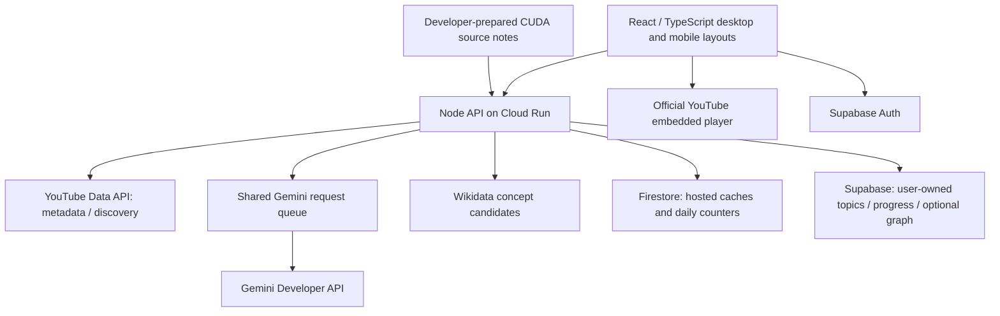

# Evaluator guide

## Project and entry points

**Revelink**, team **SSRD**, led by **Subram Das**, is an educational discovery prototype. It combines YouTube videos, a short-video feed, an in-context AI teacher, saved topics/progress and related-topic exploration. It aims to reduce the friction of switching between video and chatbot apps. Engagement and learning gains remain hypotheses, not measured results.

- Website: https://revelink-u2ubbw6fra-el.a.run.app
- Health: https://revelink-u2ubbw6fra-el.a.run.app/api/health
- [Data sources / grounding](DATA_SOURCES.md)
- [Demo checklist / sample questions](DEMO_CHECKLIST.md)
- [Evidence / benchmarks](RESULTS.md)

Use the public guest experience first; no judge credentials, Google Cloud login or Supabase account are required. The website's external APIs still need available provider allowance. To run a separate local copy, supply your own credentials. This repo does not include private keys or a bundled offline video dataset.

## Architecture and AI use

The model is configured by `GEMINI_MODEL`; there is no automatic model substitution or training step. The current app calls the Gemini Developer API, not Vertex AI. Search/teacher/classification reuse one process-local queue; the deployment helper caps the service at one instance. Separate services or developer scripts do not share that queue.

Search assesses intent, retrieves public YouTube metadata, and filters candidates for educational purpose. Classification extracts a topic, retrieves Wikidata candidates, and resolves a primary Universe plus substantial overlaps. Teaching optionally sends an eligible public video URL to Gemini and always supplies the small checked-note fixture. General answers are permitted and labeled. [Grounding limits](DATA_SOURCES.md#what-grounding-means-here).

## Reproduce locally

1. Install Node **22+** and npm. Clone/download the submitted repository and enter its root.
2. Run `npm ci` using the pinned lockfile.
3. If `.env` is absent, copy `.env.example` to `.env`. Fill the settings below in a local editor. Never commit it.
4. Read [prototype data-use notes](../../PHASE_2_SETUP.md); use non-sensitive adult demo inputs.
5. Run `npm run dev`, open **http://127.0.0.1:5173**, and keep the terminal running. API: **http://127.0.0.1:8787**.
6. Follow [the demo checklist](DEMO_CHECKLIST.md). Restart the server after changing environment settings.

No dataset download, model training, Firestore setup or database migration is needed for the core local guest journey. It requires network access and valid YouTube/Gemini credentials. With no keys, automated service tests and the build are still available; live search/chat should report configuration errors, not fabricated results.

## Configuration

| Setting                                               | Purpose / requirement                                                                                                           |
| ----------------------------------------------------- | ------------------------------------------------------------------------------------------------------------------------------- |
| `YOUTUBE_API_KEY`                                     | Required for live public video search and details; enable YouTube Data API v3 in your Google project                            |
| `GEMINI_API_KEY`                                      | Required for live teacher, search checks and video classification                                                               |
| `GEMINI_MODEL`                                        | An exact model ID available to your project; do not prepend `models/`. Video URL support depends on model/provider availability |
| `ALLOW_GEMINI_FREE_TEST=true`                         | Explicit consent to the prototype's external model calls after reviewing data-use notes; not a billing guarantee                |
| `YOUTUBE_SEARCH_PAGE_SIZE=10`                         | Candidate count per page, allowed 1–20; filtering can return fewer                                                              |
| `VIDEO_CLASSIFICATION=true`                           | Enables background topic/Universe labels with valid Gemini configuration                                                        |
| `CLASSIFICATION_DAILY_LIMIT=400`                      | Model-attempt cap, not number of videos; normally two requests/new video                                                        |
| `GEMINI_REQUEST_INTERVAL_MS=5000`                     | Minimum request-start spacing across the app queue; provider limits still apply                                                 |
| `SEARCH_DAILY_LIMIT=40`                               | App allowance for YouTube provider operations, not a literal provider quota-unit count                                          |
| `SEARCH_GUARD_DAILY_LIMIT=40`                         | Gemini intent / video-purpose checks                                                                                            |
| `CHAT_DAILY_LIMIT=25`                                 | Teacher attempt allowance                                                                                                       |
| `CHAT_VIDEO_CONTEXT=true`, `VIDEO_CHAT_DAILY_LIMIT=8` | Optional eligible public-video analysis and its separate attempt cap                                                            |
| `SUPABASE_URL`, `SUPABASE_PUBLISHABLE_KEY`            | Optional accounts and user-owned storage; use a publishable/anon key, never a privileged key                                    |
| `LEARNING_GRAPH_ENABLED=false`                        | Keep disabled for a fresh setup until graph schema and reviewed content are published                                           |

Local counters/cache files live under ignored `.local-data`; do not delete counters to bypass quotas. App counters reset by UTC day; recognized provider daily blocks follow Pacific time. Caps do not reserve a combined pool across features or external clients. A provider limit of 500/day has not been independently verified for the configured project/model.

## Optional accounts and graph

For account saving, use a Supabase project you control. Apply migrations [001](../../supabase/migrations/001_saved_topics.sql) and [002](../../supabase/migrations/002_video_progress.sql) in order. Review their RLS policies and run the corresponding [ownership checks](../../supabase/tests). Configure Site URL and allowed redirect URLs for your localhost/deployed origin. Enable email confirmation and configure email delivery. Guest records do not automatically transfer to an account.

The graph additionally requires migration [003](../../supabase/migrations/003_learning_graph.sql), review/publication of catalog content and the feature flag. Its checked-in starter has **30 concepts / 26 proposed connections, zero videos and zero events**. The manifest currently has `reviewed: true`, but still describes itself as a draft and contains empty topic-source lists and unset QIDs; independent review and live publication were not verified in this documentation pass. An implementation or enabled flag is not evidence that reviewed live content exists. Follow [graph setup](../../backend/graph/README.md); do not mark a draft reviewed merely to display a populated screen.

## Current scope and limitations

| Capability         | Source behavior and practical limit                                                                                                                               |
| ------------------ | ----------------------------------------------------------------------------------------------------------------------------------------------------------------- |
| Discovery          | YouTube only; no Instagram/Reels API integration. Short grouping is duration-based, not verified official Shorts status                                           |
| Educational search | AI intent/purpose checks; subject membership and popularity do not prove quality or accuracy                                                                      |
| Teacher            | Notes/video/general basis; video input limited to eligible public videos up to 30 minutes; unsupported input can fall back to text                                |
| Topic mapping      | Cached Gemini/Wikidata results; provisional labels allowed; no claim of human-reviewed taxonomy accuracy                                                          |
| Related break      | Explicit 30-second demo supported in current source, normal 12-minute active-learning UI; server checks elapsed time, not verified attention; at most three clips |
| Progress           | Playback position and exploration activity, not understanding or mastery                                                                                          |
| Graph              | Optional activation/publication work; no bundled reviewed teaching-video catalog                                                                                  |
| Responsive UI      | Separate desktop/mobile layouts; some reviewed desktop presentation flows are not yet at mobile parity                                                            |

The release report records a `revelink` deployment on 2026-10-18. It does not contain a source revision or prove the later demo-timer fix was deployed. Source behavior here should be checked against the actual website before recording the submission video.

## Verification and deployment

Run `npm test` and `npm run build`. Browser checks use `npm run test:browser`; install Chromium with `npx playwright install chromium` if no supported browser is installed. These checks simulate external providers/accounts; see [recorded results](RESULTS.md).

Benchmark plans make no API calls. Append `--live` only with a running app and available allowance; [commands and reviewed-label format](../../experiments/benchmarks/README.md). Do not interpret unreviewed cases as accuracy evidence.

For the existing owner's Cloud Run setup, `node deployment/google-cloud.mjs deploy` uses ignored secret-version metadata and updates the configured service. A fresh clone does not have that owner-specific file. Initial cloud provisioning is an owner task, not a prerequisite for judging or local guest use. See [deployment guide](../../GOOGLE_CLOUD_DEPLOYMENT.md).

## Troubleshooting

| Symptom                            | Check                                                                                                           |
| ---------------------------------- | --------------------------------------------------------------------------------------------------------------- |
| Port 8787 in use                   | Stop the earlier dev server; keep one local instance                                                            |
| Missing model/API configuration    | Populate `.env`, confirm API/model access, restart backend                                                      |
| Daily label/teacher/search limit   | Wait for the applicable reset or review genuine provider/project usage; restart does not restore quota          |
| Labels appear slowly               | Shared queue prioritizes teacher/search; cached results avoid new Gemini calls                                  |
| No timestamp                       | Check analysis eligibility, notices and context label; a general answer must not invent video timings           |
| Break offered but “not ready”      | Refresh after deploying the timer fix and start a fresh demo session; normal and demo waits differ              |
| Account confirmation not received  | Check Supabase sender configuration, rate limits and redirect URLs; request success is not email delivery proof |
| Explore empty/unavailable          | Check graph schema, publication and flag; draft content is not automatically imported                           |
| Health works but search/chat fails | Health only checks server response; inspect feature error/quota/configuration separately                        |

Avoid adding personal data, keys, tokens or full private conversations to screenshots, review reports or issue descriptions.
